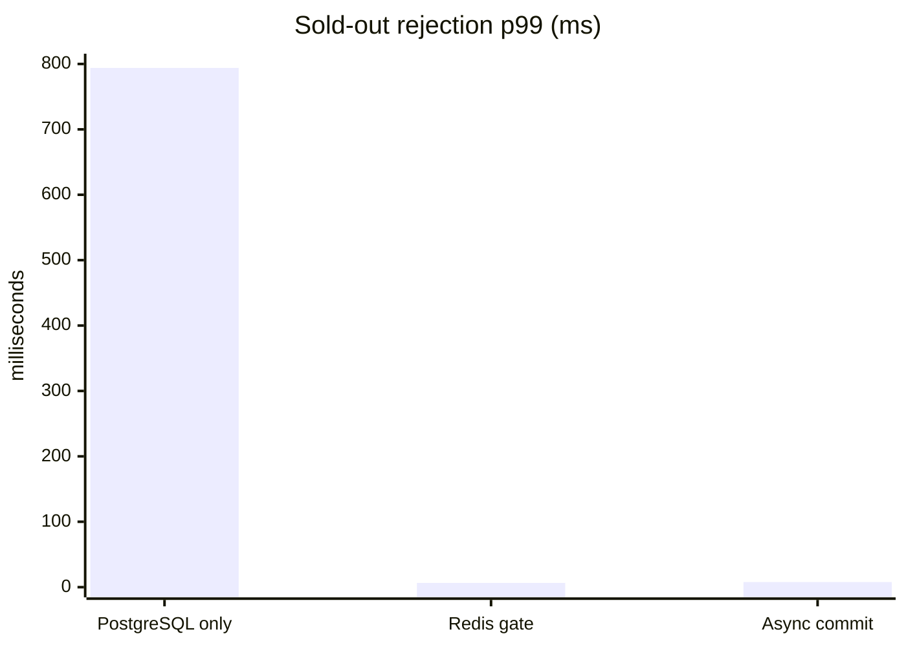
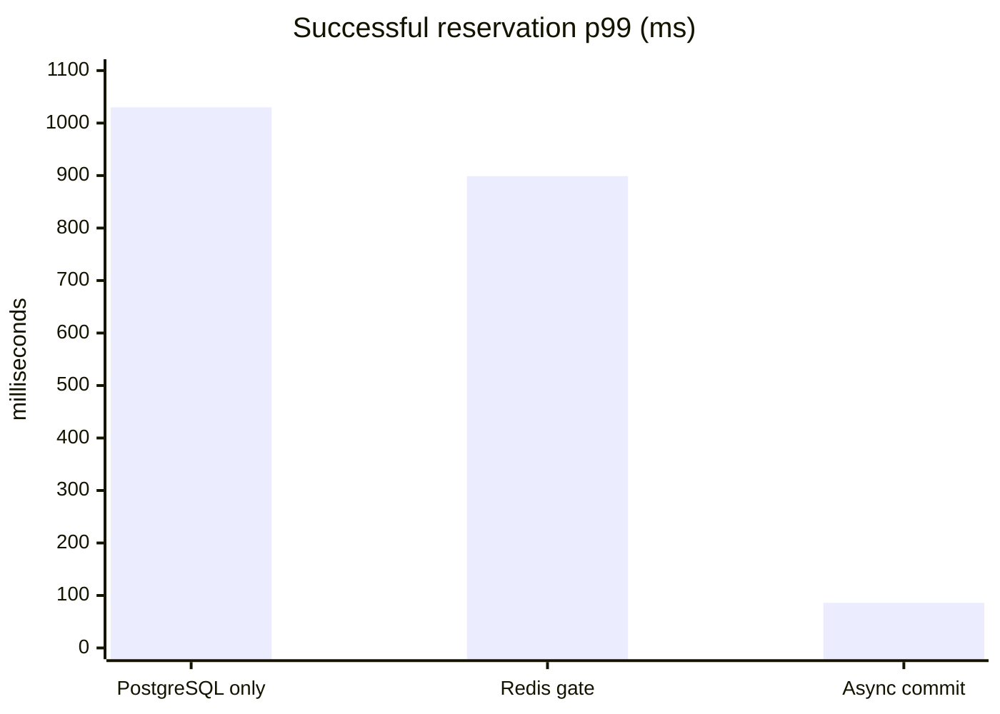
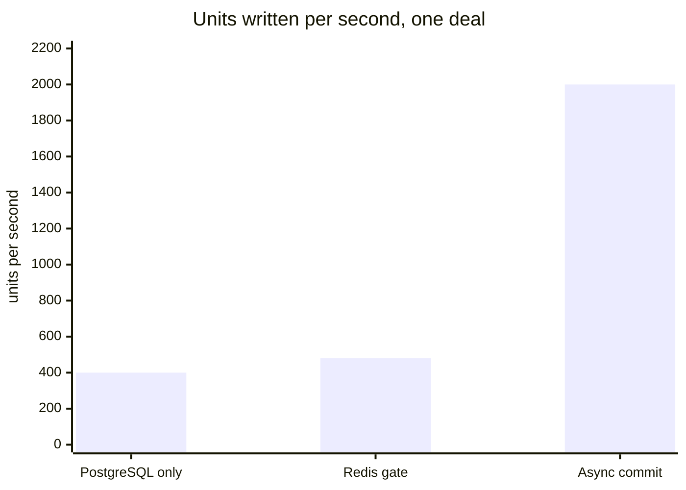

# FlashDeal Service

High-concurrency flash-sale API in Go. It sells a limited stock during a short
window with **zero overselling** under heavy load.

> **Status:** phase 7 (performance and resilience) complete. Reservations pass
> an atomic Lua gate in Redis before reaching PostgreSQL. Abandoned holds
> expire, the gate is reconciled from PostgreSQL, and the service is measured
> under load and chaos. See the implementation plan in
> [`docs/ARCHITECTURE.md`](docs/ARCHITECTURE.md) (section 7).

## Requirements

- Go (version pinned in `go.mod`; the `toolchain` line is fetched automatically)
- Docker with Compose v2
- GNU make
- `golangci-lint` v2 and `govulncheck` for `make lint`
- On Windows, a C compiler (for example MinGW-w64) for `go test -race`

## Quick start

```bash
make up
make migrate
curl -i localhost:8080/readyz
make down
```

`make up` builds the API image and starts PostgreSQL, Redis, the API and the
observability stack, waiting until they are healthy. `make migrate` applies
the SQL schema in [`migrations/`](migrations).

| Service    | URL                                           |
| ---------- | --------------------------------------------- |
| API        | <http://localhost:8080>                         |
| Grafana    | <http://localhost:3000> (FlashDeal dashboard)   |
| Prometheus | <http://localhost:9090>                         |
| Jaeger     | <http://localhost:16686>                        |
| pprof      | <http://localhost:6060/debug/pprof/>            |

Everything except the API is bound to `127.0.0.1`. `make up PROFILES=`
starts only the API, PostgreSQL and Redis.

`make test-integration` starts a disposable PostgreSQL with testcontainers, so
Docker must be running.

## Results

These numbers were measured with k6 against the local Docker Compose stack:
one Docker Desktop VM with 4 CPUs and 9.7 GiB, shared by k6, the API,
PostgreSQL, Redis and, from phase 6, the observability stack. The deal has
one row and the pool has 20 connections. They show how the design behaves,
not production capacity. Every run sold **exactly** the deal's stock:
**zero units oversold in every load and chaos run**.

The same k6 scenario ([`test/load/flash_sale.js`](test/load/flash_sale.js))
was run against three versions of the service:

| Version              | What decides a reservation                                                              |
| -------------------- | --------------------------------------------------------------------------------------- |
| PostgreSQL only (phase 3) | A conditional `UPDATE` on the deal's row, for every attempt                        |
| Redis gate (phase 4) | An atomic Lua script in Redis; only admitted buyers reach PostgreSQL                    |
| Async commit (phase 7) | The gate, plus reservation transactions that no longer wait for the WAL fsync ([ADR 0006](docs/adr/0006-asynchronous-commit-for-reservations.md)) |

### Scenario B: 1,000 units, about 55,000 buyers

This is the architecture document's case:
`STOCK=1000 PEAK_RPS=5000 RAMP=2s HOLD=10s make load`. Of the buyers, 98 %
must be turned away.





| Metric                           | PostgreSQL only   | Redis gate        | Async commit         |
| -------------------------------- | ----------------- | ----------------- | -------------------- |
| Requests served                  | 39 357 (3 169/s)  | 54 422 (4 532/s)  | 55 000 (4 584/s)     |
| Sold-out rejection p50 / p99     | 523 ms / 794 ms   | 0.40 ms / 6.5 ms  | 0.45 ms / 7.8 ms     |
| Successful reservation p50 / p99 | 483 ms / 1.03 s   | 434 ms / 899 ms   | **0.96 ms / 86 ms**  |
| Timeouts                         | 0                 | 0                 | 0                    |

With the gate, a sold-out buyer is answered from Redis in memory and never
reaches PostgreSQL, so rejections drop from 794 ms to single-digit
milliseconds. Successful reservations stayed slow until phase 7 found why.
Each `COMMIT` held the deal's row lock while it waited for its WAL fsync, so
sales queued behind one another. Committing reservations asynchronously
took their p50 from 434 ms to under 1 ms.

### Scenario A: 10,000 units at 5,000 attempts per second

This is the `make load` default, where the stock is larger than one row can
absorb in time.



| Metric                           | PostgreSQL only  | Redis gate         | Async commit        |
| -------------------------------- | ---------------- | ------------------ | ------------------- |
| Requests served                  | 13 489 (588/s)   | 34 604 (1 573/s)   | **96 841 (4 402/s)** |
| Timeouts (503, rolled back)      | 0                | 5 909 (17 %)       | **0**               |
| Successful reservation p99       | 4.43 s           | 4.64 s             | 986 ms              |
| Sold-out rejection p99           | 4.16 s           | 22 ms              | 562 ms              |

With the gate but synchronous commits, Redis admitted buyers faster than
PostgreSQL could write them. Admitted buyers queued until the timeout, and
each timeout gave its unit back to admit another buyer. At about 2,000
writes per second that loop is gone, and so are the timeouts.

### Against the design targets

`flash_sale.js` fails a run that misses a target. The targets stay as
written instead of being relaxed to pass.

| Target (docs/ARCHITECTURE.md)                  | Result                                                     |
| ---------------------------------------------- | ---------------------------------------------------------- |
| 0 units oversold under any load                | ✅ every load and chaos run                                |
| Sold-out rejection p99 < 10 ms                 | ✅ 7.8 ms in scenario B · ❌ 562 ms in A, with the CPUs saturated |
| Successful reservation p99 < 50 ms             | ❌ 86 ms in B, 986 ms in A: one round trip per sale on one row, on 4 shared CPUs |
| Redis down: fail closed with `503`             | ✅ 2,500 of 2,500 reservations refused, slowest in 12 ms, none sold |
| Graceful shutdown without losing requests      | ✅ `SIGTERM` under load: exit code 0, every sale answered  |

The next lever for the reservation p99 is splitting a deal's stock over
several rows ([ADR 0006](docs/adr/0006-asynchronous-commit-for-reservations.md),
alternatives). Stateless replicas are part of the design: the stock lives in
Redis and PostgreSQL, and expiry and reconciliation are safe on any number of
replicas. Load was measured on a single replica.

### Chaos under load

`make test-chaos` breaks the running stack while about 500 reservations per
second keep arriving ([details](test/load/results/chaos.md)):

- **Redis stopped for 5 s.** Every reservation sent during the outage got
  `503 STOCK_UNAVAILABLE` within 12 ms. Sales resumed on their own when
  Redis returned, and PostgreSQL held exactly the units answered `201`. The
  first run took 5 s per `503` because of go-redis retries; the client now
  fails fast ([ADR 0007](docs/adr/0007-fail-fast-redis-client.md)).
- **API stopped with `SIGTERM`.** It answered every request it had accepted
  and exited with code 0. PostgreSQL held exactly the units answered `201`.

### On the dashboard

A k6 run on the Grafana dashboard shows a deal's gate stock falling to 0 in
under a second. The `SOLD_OUT` rate climbs to the offered 5,000 requests per
second and is 98.1 % of attempts. The PostgreSQL pool is pinned at 20 of 20
while the units are written
([details](test/load/results/observability.md)).

### Detailed results

- [Phase 3: PostgreSQL only](test/load/results/baseline-postgres.md)
- [Phase 4: Redis gate vs PostgreSQL only](test/load/results/redis-gate.md)
- [Phase 6: a flash sale on the dashboard](test/load/results/observability.md)
- [Phase 7: the write path, profiled and fixed](test/load/results/write-path.md)
- [Phase 7: chaos under load](test/load/results/chaos.md)

## Endpoints

The full contract is in [`api/openapi.yaml`](api/openapi.yaml). Every error
uses the body `{"code", "message", "request_id"}`.

| Method   | Path                            | Purpose                                                        |
| -------- | ------------------------------- | -------------------------------------------------------------- |
| `POST`   | `/v1/deals`                     | Create a deal (admin)                                          |
| `POST`   | `/v1/deals/{id}/activate`       | Open a deal's stock for reservations (admin)                  |
| `GET`    | `/v1/deals/{id}`                | Get a deal with its approximate available stock                |
| `GET`    | `/v1/deals?status=active`       | List active deals (cursor pagination)                          |
| `POST`   | `/v1/deals/{id}/reservations`   | Reserve units; needs `X-User-ID` and `Idempotency-Key`         |
| `POST`   | `/v1/reservations/{id}/confirm` | Confirm a reservation and create its order (`X-User-ID`)       |
| `DELETE` | `/v1/reservations/{id}`         | Cancel a pending reservation (`X-User-ID`)                     |
| `GET`    | `/healthz`                      | Liveness: the process is up (never checks dependencies)        |
| `GET`    | `/readyz`                       | Readiness: PostgreSQL and Redis are reachable (`200` or `503`) |
| `GET`    | `/metrics`                      | Prometheus metrics (see [Observability](#observability))       |

### Behavior notes and known limitations

- A deal must be **activated** (`POST /v1/deals/{id}/activate`) before it can
  be reserved: activation loads its stock into the Redis gate.
- The per-user limit is cumulative across a user's reservations on a deal and
  holds under parallel requests (enforced atomically in Redis).
- If Redis is unreachable, reservations fail closed with `503
  STOCK_UNAVAILABLE` within milliseconds (the Redis client never retries,
  [ADR 0007](docs/adr/0007-fail-fast-redis-client.md)); nothing is sold
  without the gate, and sales resume when Redis returns. `make test-chaos`
  proves it under load ([results](test/load/results/chaos.md)).
- Reservations are idempotent per user and `Idempotency-Key`: a retry replays
  the original response (marked `Idempotency-Replayed: true`) for 24 h, and a
  retry while the first request is still running gets `409
  IDEMPOTENCY_IN_PROGRESS`.
- Admin endpoints (`POST /v1/deals`, `/activate`) are not authenticated yet.
- `X-User-ID` stands in for real authentication; the middleware is the seam
  where JWT validation will go.
- Unconfirmed reservations expire after `RESERVATION_TTL` (5 min); the
  expirer returns their units within `EXPIRE_EVERY`.
- Successful reservations of one deal still serialize on its `deals` row:
  about 2,000 per second locally, after reservation transactions moved to
  asynchronous commit ([ADR 0006](docs/adr/0006-asynchronous-commit-for-reservations.md);
  [results](test/load/results/write-path.md)). A PostgreSQL crash can lose
  the last few hundred milliseconds of reservations, never orders and never
  into an oversell.

## Make targets

| Target                  | What it does                                            |
| ----------------------- | ------------------------------------------------------- |
| `make up` / `make down` | Start / stop the local stack                            |
| `make migrate`          | Apply database migrations (golang-migrate container)    |
| `make test`             | Unit tests with the race detector                       |
| `make test-integration` | Integration tests against real Postgres and Redis       |
| `make test-e2e`         | End-to-end tests over HTTP against the running stack     |
| `make test-chaos`       | Stop Redis and the API under load; check 503s, no oversell and a clean exit |
| `make lint`             | `golangci-lint` (including layer rules) + `govulncheck` |
| `make lint-api`         | Validate `api/openapi.yaml` with Redocly (Docker)        |
| `make load`             | k6 flash-sale scenario against the running stack        |
| `make build`            | Build the binary into `bin/`                            |

## Configuration

All configuration comes from environment variables; see
[`.env.example`](.env.example) for the full list and defaults.

## Background workers

Workers run inside the API process, share its lifecycle and stop with it
on `SIGTERM`. Every replica runs them; they need no leader election.

- **Expirer** (`EXPIRE_EVERY`, default 5s): marks pending reservations
  past their TTL as `expired` and returns their units to the deal and to
  the Redis gate. Batches of `EXPIRE_BATCH_SIZE` rows are claimed with
  `FOR UPDATE SKIP LOCKED`, so replicas never process the same row.
- **Reconciler** (`RECONCILE_EVERY`, default 30s): compares the Redis gate
  of every active deal with PostgreSQL and, when a release was lost,
  restores the stock and the per-buyer holdings from PostgreSQL. It only
  repairs a disagreement that stood still for two consecutive passes, with
  a compare-and-set, so it never fights an operation in flight. Repairs are
  logged as `stock gate drift repaired`. See
  [ADR 0005](docs/adr/0005-stock-gate-reconciliation.md).
- **Stock sampler** (`STOCK_SAMPLE_EVERY`, default 5s): publishes the units
  left in the gate for every active deal as `stock_remaining{deal_id}`.

## Observability

`GET /metrics` serves Prometheus metrics:

| Metric                                     | What it shows                                                   |
| ------------------------------------------ | --------------------------------------------------------------- |
| `http_requests_total{method,route,status}` | Traffic per route pattern and status                            |
| `http_request_duration_seconds{method,route}` | Latency histogram per route pattern                          |
| `reservations_total{result}`               | Reservation attempts: `created`, `sold_out`, `user_limit_reached`, `request_timeout`, ... |
| `stock_remaining{deal_id}`                 | Units left in the Redis gate per active deal                    |
| `reservations_expired_total`               | Reservations returned to stock by the expirer                   |
| `stock_gate_repairs_total`                 | Gates corrected by the reconciler (each one is a lost update)   |
| `db_pool_*`                                | PostgreSQL pool usage and time spent waiting for a connection   |

Profiling (`net/http/pprof`) is served on a separate admin listener,
`ADMIN_ADDR` (default `:6060`), which Docker Compose publishes on
`127.0.0.1` only. For example, a 10-second CPU profile:

```bash
go tool pprof "http://localhost:6060/debug/pprof/profile?seconds=10"
```

### Dashboard

Grafana opens on the **FlashDeal - flash sale** dashboard, versioned in
[`deploy/grafana/dashboards/flashdeal.json`](deploy/grafana/dashboards/flashdeal.json)
(provisioned read-only: edit the JSON, not the UI). It shows the stock left
in the gate per deal, reservation outcomes, the sold-out share, request
timeouts, gate repairs, p99 latency and status per route, the PostgreSQL
pool and time spent waiting for a connection. Prometheus scrapes the API
every second, and Compose samples the stock every second too
([`deploy/prometheus.yml`](deploy/prometheus.yml)): a deal's gate empties in
under a second. Run `make
load` with the stack up to watch a deal sell out.

### Tracing

With `TRACING_OTLP_ENDPOINT` set (an OTLP/HTTP collector such as Jaeger;
Docker Compose points it at `http://jaeger:4318` and samples 10 % of new
traces), the service exports OpenTelemetry traces:

- one server span per `/v1` request, named after its route
  (`POST /v1/deals/{id}/reservations`), continuing the caller's trace when
  the request carries a W3C `traceparent` header;
- one client span per PostgreSQL query (`db.query.text` holds the
  parameterized SQL; values are never recorded) and per Redis command or
  pipeline;
- one span per worker pass (`worker.expire`, `worker.reconcile`,
  `worker.sample_stock`).

`TRACING_SAMPLE_RATIO` (default `1`) is the share of new traces kept.
Requests inside a sampled trace are always kept. Log lines written during a
traced request carry its `trace_id` and `span_id`. With no endpoint, tracing
is off and costs nothing.

## Project layout and rules

- Design and rationale: [`docs/ARCHITECTURE.md`](docs/ARCHITECTURE.md) (Spanish)
- Engineering rules for contributors and coding agents: [`CLAUDE.md`](CLAUDE.md)
