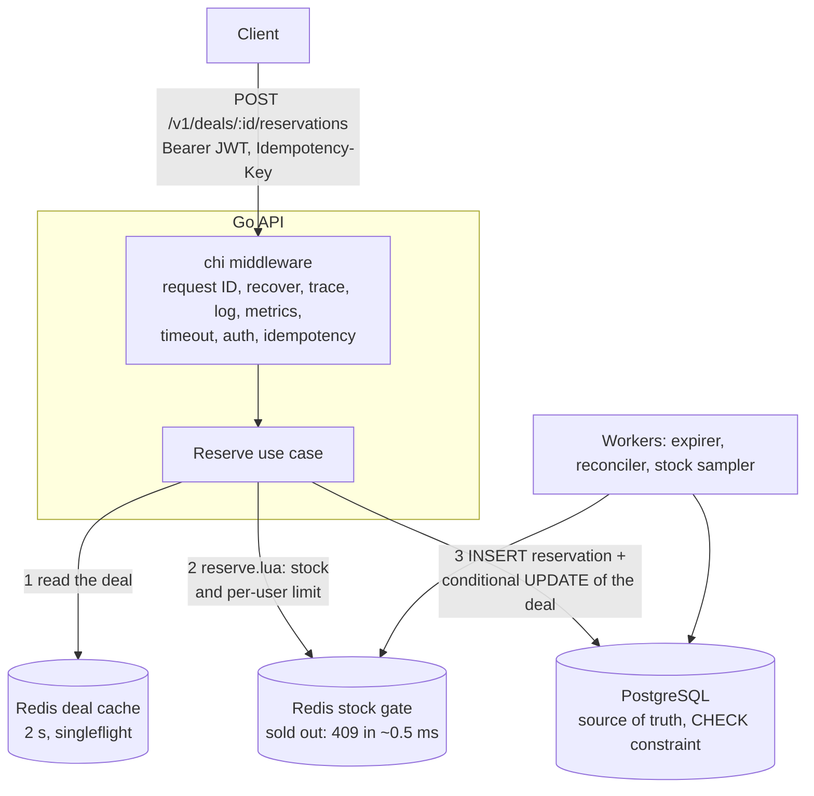
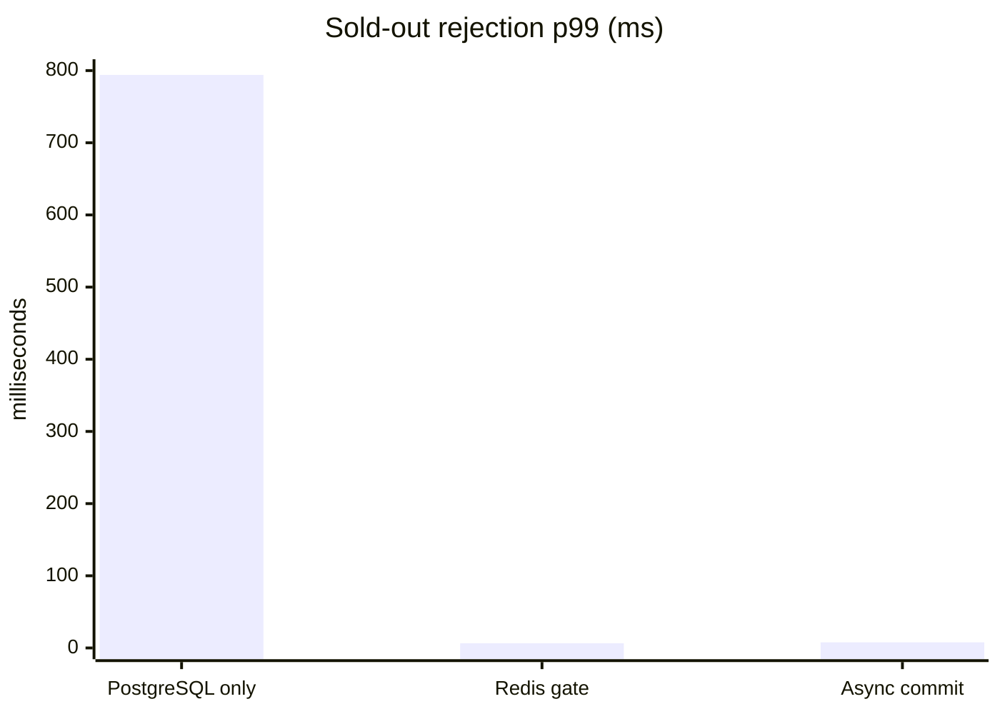
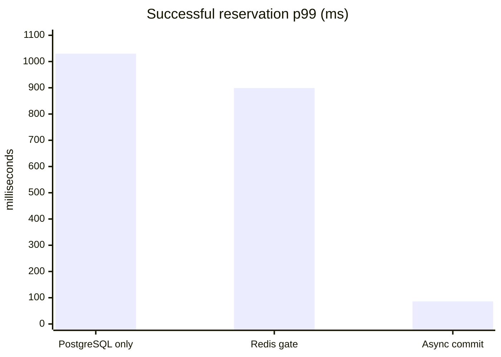
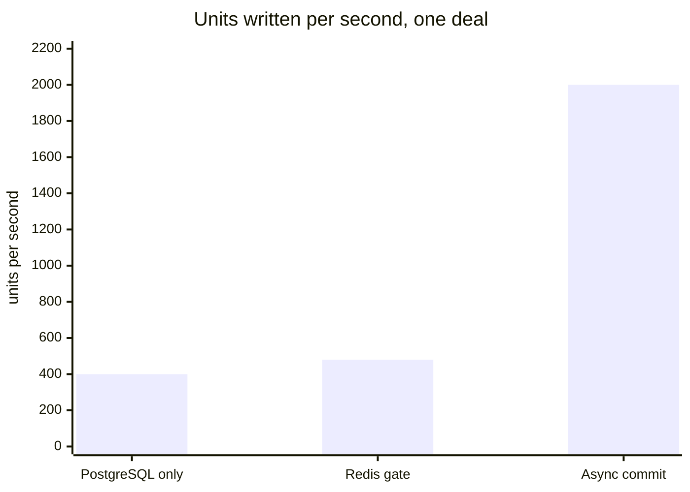

# FlashDeal Service

[](https://github.com/whoyoshome/flashdeal-service/actions/workflows/ci.yml)

A flash-sale API in Go that sells a limited stock to a crowd in seconds and
**never oversells**. A Redis Lua script answers the 98 % of buyers who
arrive too late in about half a millisecond (p50), and PostgreSQL stays the
source of truth for the rest. The service is measured under load and chaos, with the
numbers below.

## The problem

A flash sale puts 1,000 units in front of 50,000 buyers who all arrive in
the first seconds. Done naively, it goes wrong in several ways at once:

| Problem                         | What goes wrong                                        | How FlashDeal handles it                                                                 |
| ------------------------------- | ------------------------------------------------------ | ---------------------------------------------------------------------------------------- |
| Overselling                     | Two requests read "1 left" and both sell               | An atomic Lua script in Redis, then a conditional `UPDATE` and a `CHECK` in PostgreSQL     |
| Hot row                         | Every attempt queues for the lock on the deal's row     | The Redis gate rejects sold-out buyers in memory; only admitted buyers reach PostgreSQL  |
| Thundering herd on reads        | Thousands of identical `GET /deals/{id}` hit the database | A 2 s Redis cache with `singleflight`                                                  |
| Double purchase on retry        | A client times out, retries and buys twice              | `Idempotency-Key`: the original response is replayed, backed by a `UNIQUE` constraint    |
| One buyer hoarding the stock    | A user reserves everything                              | A per-user limit checked in the same atomic script                                       |
| Abandoned reservations          | Units held forever by buyers who never pay              | An expiry worker using `FOR UPDATE SKIP LOCKED`, safe on any number of replicas          |
| Redis and PostgreSQL disagreeing | A lost update leaves the gate wrong                    | Compensation, plus a reconciler that repairs the gate from PostgreSQL                    |
| Redis down                      | Selling without control                                 | Fail closed: `503` within milliseconds, nothing sold                                     |

## How it works



A reservation goes through three steps:

1. **Read the deal.** The deal comes from a short-lived cache. Concurrent
   misses collapse into one database read.
2. **Pass the gate.** One Redis round trip checks and decrements the stock
   and the buyer's per-user limit atomically. A buyer who arrives too late
   is answered `409 SOLD_OUT` here and never reaches PostgreSQL.
3. **Write the reservation.** An admitted buyer's reservation is inserted
   in PostgreSQL in the same transaction as a conditional `UPDATE` of the
   deal's counters, guarded by `CHECK (reserved + sold <= total_stock)`. If
   the write fails, the units go back to the gate.

The reservation holds its units for 5 minutes. Confirming it creates the
order. If it is not confirmed in time, the expirer returns the units.

The code follows a strict inward dependency rule,
`delivery → usecase → domain`, enforced by `depguard`. Adapters in
`repository` implement small interfaces declared by the use cases, and
`cmd/api/main.go` wires everything by hand.

```text
cmd/api/                composition root: config, wiring, startup and shutdown
internal/domain/        entities and invariants (Deal, Reservation, Order), stdlib only
internal/usecase/       business operations and the ports they need
internal/delivery/      HTTP: chi router, middleware, DTOs, error mapping
internal/repository/    adapters: postgres (pgx) and redisrepo (go-redis, Lua scripts)
internal/worker/        expirer, reconciler and stock sampler
internal/platform/      config, logging, clock, IDs, metrics and tracing
migrations/             SQL schema
api/openapi.yaml        HTTP contract
deploy/                 Prometheus, Grafana, and Kubernetes manifests (hardened pods, migration Job, HPA, PDB)
test/                   e2e, chaos and k6 load tests with their results
```

## Quick start

You need Docker with Compose v2 and GNU make. One command starts the API,
PostgreSQL, Redis, Jaeger, Prometheus and Grafana. It then runs a short
flash sale against them: 1,000 units sold to about 20,000 buyers.

```bash
make demo
```

Then open the **FlashDeal - flash sale** dashboard at
<http://localhost:3000> to watch the deal sell out. Run `make demo` again
for another sale, and `make down` to stop everything.

| Service    | URL                                  |
| ---------- | ------------------------------------ |
| API        | <http://localhost:8080>              |
| Grafana    | <http://localhost:3000>              |
| Prometheus | <http://localhost:9090>              |
| Jaeger     | <http://localhost:16686>             |
| pprof      | <http://localhost:6060/debug/pprof/> |

Postgres, Redis, the API, pprof, Grafana, Prometheus and Jaeger bind to
`127.0.0.1` on the host. If a local PostgreSQL or Redis already uses 5432 or
6379, set `POSTGRES_HOST_PORT` or `REDIS_HOST_PORT` in a `.env` file (see
[`.env.example`](.env.example)); nothing else changes, since the services
talk to each other inside the Compose network.

To try the API by hand (Bearer JWTs; mint with `make token`):

```bash
make up && make migrate
ADMIN=$(TOKEN_ROLE=admin TOKEN_SUB=ops make token)
USER=$(TOKEN_SUB=alice TOKEN_ROLE=user make token)
curl -s -X POST localhost:8080/v1/deals -H "Authorization: Bearer $ADMIN" \
  -H 'Content-Type: application/json' \
  -d '{"product_id":"sku-1","title":"Headphones","price_cents":4999,"currency":"USD","total_stock":3,"per_user_limit":1,"starts_at":"2026-01-01T00:00:00Z","ends_at":"2030-01-01T00:00:00Z"}'
# Use the "id" returned above: 1 on a fresh database.
curl -s -X POST localhost:8080/v1/deals/1/activate -H "Authorization: Bearer $ADMIN"
curl -s -X POST localhost:8080/v1/deals/1/reservations -H 'Content-Type: application/json' \
  -H "Authorization: Bearer $USER" -H 'Idempotency-Key: alice-1' -d '{"quantity":1}'
```

To develop, you also need Go (the version is pinned in `go.mod`, and the
`toolchain` line downloads it automatically). `make lint` needs
`golangci-lint` v2 and `govulncheck`. On Windows, `go test -race` needs a C
compiler such as MinGW-w64.

## Results

These numbers were measured with k6 against the local Docker Compose stack:
one Docker Desktop VM with 4 CPUs and 9.7 GiB, shared by k6, the API,
PostgreSQL, Redis and, from phase 6, the observability stack. The deal has
one row and the pool has 20 connections. They show how the design behaves,
not production capacity. Every run sold **exactly** the deal's stock:
**zero units oversold in every load and chaos run**.

The same k6 scenario ([`test/load/flash_sale.js`](test/load/flash_sale.js))
was run against three versions of the service:

| Version              | What decides a reservation                                                              |
| -------------------- | --------------------------------------------------------------------------------------- |
| PostgreSQL only (phase 3) | A conditional `UPDATE` on the deal's row, for every attempt                        |
| Redis gate (phase 4) | An atomic Lua script in Redis; only admitted buyers reach PostgreSQL                    |
| Async commit (phase 7) | The gate, plus reservation transactions that no longer wait for the WAL fsync ([ADR 0006](docs/adr/0006-asynchronous-commit-for-reservations.md)) |

### Scenario B: 1,000 units, about 55,000 buyers

This is the architecture document's case:
`STOCK=1000 PEAK_RPS=5000 RAMP=2s HOLD=10s make load`. Of the buyers, 98 %
must be turned away.





| Metric                           | PostgreSQL only   | Redis gate        | Async commit         |
| -------------------------------- | ----------------- | ----------------- | -------------------- |
| Requests served                  | 39 357 (3 169/s)  | 54 422 (4 532/s)  | 55 000 (4 584/s)     |
| Sold-out rejection p50 / p99     | 523 ms / 794 ms   | 0.40 ms / 6.5 ms  | 0.45 ms / 7.8 ms     |
| Successful reservation p50 / p99 | 483 ms / 1.03 s   | 434 ms / 899 ms   | **0.96 ms / 86 ms**  |
| Timeouts                         | 0                 | 0                 | 0                    |

With the gate, a sold-out buyer is answered from Redis in memory and never
reaches PostgreSQL, so rejections drop from 794 ms to single-digit
milliseconds. Successful reservations stayed slow until phase 7 found why.
Each `COMMIT` held the deal's row lock while it waited for its WAL fsync, so
sales queued behind one another. Committing reservations asynchronously
took their p50 from 434 ms to under 1 ms.

Both scenarios were measured again after every reservation started carrying
a JWT that the API verifies. The results did not change beyond run-to-run
noise: in scenario B, 0.45 ms / 7.4 ms for rejections and 0.94 ms / 91 ms
for successful reservations
([details](test/load/results/jwt-auth.md)).

### Scenario A: 10,000 units at 5,000 attempts per second

This is the `make load` default, where the stock is larger than one row can
absorb in time.



| Metric                           | PostgreSQL only  | Redis gate         | Async commit        |
| -------------------------------- | ---------------- | ------------------ | ------------------- |
| Requests served                  | 13 489 (588/s)   | 34 604 (1 573/s)   | **96 841 (4 402/s)** |
| Timeouts (503, rolled back)      | 0                | 5 909 (17 %)       | **0**               |
| Successful reservation p99       | 4.43 s           | 4.64 s             | 986 ms              |
| Sold-out rejection p99           | 4.16 s           | 22 ms              | 562 ms              |

With the gate but synchronous commits, Redis admitted buyers faster than
PostgreSQL could write them. Admitted buyers queued until the timeout, and
each timeout gave its unit back to admit another buyer. At about 2,000
writes per second that loop is gone, and so are the timeouts.

### Against the design targets

`flash_sale.js` fails a run that misses a target. The targets stay as
written instead of being relaxed to pass.

| Target (docs/ARCHITECTURE.md)                  | Result                                                     |
| ---------------------------------------------- | ---------------------------------------------------------- |
| 0 units oversold under any load                | ✅ every load and chaos run                                |
| Sold-out rejection p99 < 10 ms                 | ✅ 7.8 ms in scenario B · ❌ 562 ms in A, with the CPUs saturated |
| Successful reservation p99 < 50 ms             | ❌ 86 ms in B, 986 ms in A: one round trip per sale on one row, on 4 shared CPUs |
| Redis down: fail closed with `503`             | ✅ 2,500 of 2,500 reservations refused, slowest in 12 ms, none sold |
| Graceful shutdown without losing requests      | ✅ `SIGTERM` under load: exit code 0, every sale answered  |

The next lever for the reservation p99 is splitting a deal's stock over
several rows ([ADR 0006](docs/adr/0006-asynchronous-commit-for-reservations.md),
alternatives). Stateless replicas are part of the design: the stock lives in
Redis and PostgreSQL, and expiry and reconciliation are safe on any number of
replicas. Load was measured on a single replica.

### Chaos under load

`make test-chaos` breaks the running stack while about 500 reservations per
second keep arriving ([details](test/load/results/chaos.md)):

- **Redis stopped for 5 s.** Every reservation sent during the outage got
  `503 STOCK_UNAVAILABLE` within 12 ms. Sales resumed on their own when
  Redis returned, and PostgreSQL held exactly the units answered `201`. The
  first run took 5 s per `503` because of go-redis retries; the client now
  fails fast ([ADR 0007](docs/adr/0007-fail-fast-redis-client.md)).
- **API stopped with `SIGTERM`.** It answered every request it had accepted
  and exited with code 0. PostgreSQL held exactly the units answered `201`.

### On the dashboard

A k6 run on the Grafana dashboard shows a deal's gate stock falling to 0 in
under a second. The `SOLD_OUT` rate climbs to the offered 5,000 requests per
second and is 98.1 % of attempts. The PostgreSQL pool is pinned at 20 of 20
while the units are written
([details](test/load/results/observability.md)).

### Detailed results

- [Phase 3: PostgreSQL only](test/load/results/baseline-postgres.md)
- [Phase 4: Redis gate vs PostgreSQL only](test/load/results/redis-gate.md)
- [Phase 6: a flash sale on the dashboard](test/load/results/observability.md)
- [Phase 7: the write path, profiled and fixed](test/load/results/write-path.md)
- [Phase 7: chaos under load](test/load/results/chaos.md)
- [JWT authentication: both scenarios measured again](test/load/results/jwt-auth.md)

## Design decisions

The full design, in Spanish, is in
[`docs/ARCHITECTURE.md`](docs/ARCHITECTURE.md). Each decision that is not
obvious has an architecture decision record:

| ADR | Decision |
| --- | -------- |
| [0001](docs/adr/0001-redis-stock-gate.md) | A Redis Lua script gates stock before PostgreSQL |
| [0002](docs/adr/0002-manual-dependency-injection.md) | Wire dependencies by hand in `main` (no Wire, no Fx) |
| [0003](docs/adr/0003-idempotent-reservation-create.md) | Idempotent reservation insert (`ON CONFLICT DO NOTHING`) |
| [0004](docs/adr/0004-singleflight-in-repository-adapters.md) | Allow `golang.org/x/sync` (`singleflight`) in repository adapters |
| [0005](docs/adr/0005-stock-gate-reconciliation.md) | Reconcile the gate only on stable drift, with compare-and-set |
| [0006](docs/adr/0006-asynchronous-commit-for-reservations.md) | Commit reservation transactions asynchronously |
| [0007](docs/adr/0007-fail-fast-redis-client.md) | Fail fast when Redis is down: no client retries |
| [0008](docs/adr/0008-jwt-authentication.md) | Bearer JWT (HS256) with `user` / `admin` roles |

## Technical overview

| Area | Implementation |
| --- | --- |
| Go backend & Clean Architecture | `delivery → usecase → domain`, enforced by `depguard` |
| HTTP/REST | Versioned `/v1` API, OpenAPI 3.1, stable error codes |
| AuthN / AuthZ (JWT) | Bearer HS256, `sub` + `role`; admin routes require `admin` ([ADR 0008](docs/adr/0008-jwt-authentication.md)) |
| Distributed correctness | Redis Lua gate + PostgreSQL `CHECK`, compensation, reconciler |
| Observability | `slog` JSON, Prometheus business metrics, OpenTelemetry → Jaeger, pprof |
| CI/CD | GitHub Actions: lint, `govulncheck`, unit, integration, e2e, image; Dependabot |
| Containers & Kubernetes | Multi-stage distroless image; [`deploy/k8s/`](deploy/k8s/): `restricted` Pod Security, read-only non-root pods, migration Job, probes, HPA, PDB, validated with kubeconform |

## API

The full contract is in [`api/openapi.yaml`](api/openapi.yaml). Every error
uses the body `{"code", "message", "request_id"}`, and clients may branch on
`code`. Authenticated routes expect `Authorization: Bearer <JWT>`.

| Method   | Path                            | Purpose                                                        |
| -------- | ------------------------------- | -------------------------------------------------------------- |
| `POST`   | `/v1/deals`                     | Create a deal (`role=admin`)                                   |
| `POST`   | `/v1/deals/{id}/activate`       | Open a deal's stock for reservations (`role=admin`)            |
| `GET`    | `/v1/deals/{id}`                | Get a deal with its approximate available stock                |
| `GET`    | `/v1/deals?status=active`       | List active deals (cursor pagination)                          |
| `POST`   | `/v1/deals/{id}/reservations`   | Reserve units; needs Bearer JWT and `Idempotency-Key`          |
| `POST`   | `/v1/reservations/{id}/confirm` | Confirm a reservation and create its order                     |
| `DELETE` | `/v1/reservations/{id}`         | Cancel a pending reservation                                   |
| `GET`    | `/healthz`                      | Liveness: the process is up (never checks dependencies)        |
| `GET`    | `/readyz`                       | Readiness: PostgreSQL and Redis are reachable (`200` or `503`) |
| `GET`    | `/metrics`                      | Prometheus metrics                                             |

Behavior worth knowing:

- **Activation.** A deal must be activated before it can be reserved:
  activation loads its stock into the Redis gate. Activating again is
  harmless.
- **Per-user limit.** It is cumulative across a user's reservations on a
  deal and holds under parallel requests.
- **Idempotency.** Reservations are idempotent per user and
  `Idempotency-Key`. A retry replays the original response, marked
  `Idempotency-Replayed: true`, for 24 h. A retry while the first request is
  still running gets `409 IDEMPOTENCY_IN_PROGRESS`, and the same key with a
  different body gets `409 CONFLICT`.
- **Overload.** A request that runs out of time is rolled back and answered
  `503 REQUEST_TIMEOUT` with `Retry-After: 1`, which is safe to retry with
  the same key. With Redis down, reservations get `503 STOCK_UNAVAILABLE`.

## Running it

### Configuration

All configuration comes from environment variables, loaded and validated
once at startup. [`.env.example`](.env.example) lists every variable with
its default. The ones that shape behavior:

| Variable | Default | Meaning |
| -------- | ------- | ------- |
| `RESERVATION_TTL` | `5m` | How long a reservation holds its units |
| `REQUEST_TIMEOUT` | `5s` | Time budget of every `/v1` request |
| `IDEMPOTENCY_TTL` | `24h` | How long a reservation response is replayed |
| `DEAL_CACHE_TTL` | `2s` | Age of the cached deal snapshot |
| `EXPIRE_EVERY`, `EXPIRE_BATCH_SIZE` | `5s`, `100` | Expirer pace and batch |
| `RECONCILE_EVERY` | `30s` | Reconciler pace; must exceed `REQUEST_TIMEOUT` by more than 5 s |
| `STOCK_SAMPLE_EVERY` | `5s` | How often `stock_remaining` is published |
| `TRACING_OTLP_ENDPOINT`, `TRACING_SAMPLE_RATIO` | empty, `1` | OTLP/HTTP collector (empty disables tracing) and share of traces kept |
| `ADMIN_ADDR` | `:6060` | pprof listener; never expose it |

### Background workers

Workers run inside the API process, share its lifecycle and stop with it
on `SIGTERM`. Every replica runs them, with no leader election.

- **Expirer.** It marks reservations past their TTL as `expired` and returns
  their units to the deal and to the gate. It claims batches with
  `FOR UPDATE SKIP LOCKED`, so replicas never process the same row.
- **Reconciler.** It repairs the Redis gate from PostgreSQL after a lost
  update. It acts only on a disagreement that stood still for two passes,
  and it uses a compare-and-set, so it never fights a request in flight
  ([ADR 0005](docs/adr/0005-stock-gate-reconciliation.md)).
- **Stock sampler.** It publishes the units left in the gate per active deal
  as `stock_remaining{deal_id}`.

### Observability

**Metrics.** `GET /metrics` serves Prometheus metrics:

| Metric | What it shows |
| ------ | ------------- |
| `http_requests_total{method,route,status}` | Traffic per route pattern and status |
| `http_request_duration_seconds{method,route}` | Latency histogram per route pattern |
| `reservations_total{result}` | Reservation attempts: `created`, `sold_out`, `user_limit_reached`, `request_timeout`, ... |
| `stock_remaining{deal_id}` | Units left in the Redis gate per active deal |
| `reservations_expired_total` | Reservations returned to stock by the expirer |
| `stock_gate_repairs_total` | Gates corrected by the reconciler (each one is a lost update) |
| `db_pool_*` | PostgreSQL pool usage and time spent waiting for a connection |

**Dashboard.** Grafana opens on the **FlashDeal - flash sale** dashboard. It
is versioned in
[`deploy/grafana/dashboards/flashdeal.json`](deploy/grafana/dashboards/flashdeal.json)
and provisioned read-only, so edit the JSON, not the UI. It shows:

- stock left per deal;
- reservation outcomes and the sold-out share;
- request timeouts and gate repairs;
- p99 latency and status per route;
- the PostgreSQL pool, including time spent waiting for a connection.

Locally, Prometheus scrapes every second and Compose samples the stock
every second, because a deal's gate empties in under a second.

**Tracing.** With `TRACING_OTLP_ENDPOINT` set, OpenTelemetry traces cover:

- each `/v1` request, named after its route and continuing a W3C
  `traceparent`;
- each PostgreSQL query, with parameterized SQL only;
- each Redis command;
- each worker pass.

Compose sends them to Jaeger and keeps 10 % of new traces. Log lines
written during a traced request carry its `trace_id`.

**Profiling.** `pprof` is served on the admin listener. For example, a
10-second CPU profile:

```bash
go tool pprof "http://localhost:6060/debug/pprof/profile?seconds=10"
```

## Testing

| Target | What it does |
| ------ | ------------ |
| `make test` | Unit tests with the race detector: table-driven, hand-written fakes, fake clock |
| `make test-integration` | Repositories against real PostgreSQL and Redis (testcontainers), including the concurrency invariants: no oversell, per-user limit, idempotency, `SKIP LOCKED` |
| `make test-e2e` | The running stack over HTTP, as a client would use it |
| `make test-chaos` | Stops Redis and then the API under load; checks `503`s, no oversell and a clean exit |
| `make load` | The k6 flash-sale scenario; fails when a design target is missed |
| `make lint` | `golangci-lint`, including the layer rules, plus `govulncheck` |
| `make lint-api` | Validates `api/openapi.yaml` with Redocly |
| `make lint-k8s` | Validates `deploy/k8s/` against the Kubernetes schemas with kubeconform |

CI runs lint, unit, integration and end-to-end tests on every pull request.
When they pass on `main` or on a `v*` tag, it publishes the image to
`ghcr.io/whoyoshome/flashdeal-service` (`main` and `sha-<commit>` from
`main`, `1.2.3` and `latest` from `v1.2.3`). Pull requests build the image
without publishing it.

## Known limitations and next steps

Limitations, all documented where they are decided:

- **Reservation latency target missed.** Successful reservations miss the
  50 ms p99 target on a laptop: 86 ms in scenario B. One deal is one row,
  which accepts about 2,000 writes per second.
- **Durability window.** Reservations commit asynchronously. A PostgreSQL
  crash can lose the last few hundred milliseconds of holds, never orders
  and never into an oversell
  ([ADR 0006](docs/adr/0006-asynchronous-commit-for-reservations.md)).
- **Per-user limit only in Redis.** In a narrow failure case a buyer could
  exceed the limit
  ([ADR 0005](docs/adr/0005-stock-gate-reconciliation.md)).
- **Redis restart without its data.** The service fails closed until the
  deals are activated again. Activation is idempotent; the reconciler does
  not reload the gate on its own.
- **JWT is HS256 with a shared secret.** Fine for a self-contained demo;
  production would verify tokens from an OIDC IdP (JWKS / RS256) behind the
  same `platform/auth` boundary
  ([ADR 0008](docs/adr/0008-jwt-authentication.md)).
- **Payments are simulated.** Confirmation assumes the payment succeeded.
- **One replica measured.** Load was measured on one replica on a shared
  4-CPU VM. Replicas are stateless by design; K8s manifests include an HPA,
  but no multi-replica load test has been run yet.

Next steps:

1. **Stock shards.** Split a deal's counters over several rows to raise
   per-deal write throughput and bring the reservation p99 under target.
2. **OIDC / JWKS verification** against a real IdP (OAuth 2.0 / OpenID Connect).
3. **A transactional outbox** to publish `order.confirmed` events.
4. **Per-user rate limiting** with a token bucket in Redis.
5. **Multi-replica load test** on the Kubernetes deployment.

## How I Used AI

This project was built with [Claude Code](https://claude.com/claude-code),
Anthropic's coding agent. I used it as a pair programmer that writes most of
the code, while I own the design, the decisions and what gets merged.

**What I gave it.** The project started from two documents:

- **[`docs/ARCHITECTURE.md`](docs/ARCHITECTURE.md):** the design, the
  stack, the layer rules and an eight-phase plan.
- **[`CLAUDE.md`](CLAUDE.md):** the engineering rules every change must
  follow. Dependencies point inward, no ORM, no `float64` money, and
  concurrency correctness lives only in Lua scripts and SQL constraints. It
  also says what needs my approval before it happens: a new dependency, a
  schema change, a change to the API contract, or more than about eight
  files touched.

**What I delegated.** I delegated the implementation of every phase:

- the domain, the use cases, the adapters, the HTTP layer and the workers;
- the unit, integration, end-to-end and chaos tests;
- the k6 scenarios and the measurements;
- the observability stack and dashboard;
- the ADRs, results files and pull request descriptions.

That came to 19 pull requests, each one phase or part of one.

**How I kept control.**

- **One phase at a time,** each starting with a written plan that I
  approved or changed.
- **Decisions stayed mine.** For example:
  - answering overloaded requests with a retryable `503 REQUEST_TIMEOUT`
    instead of `500`;
  - how idempotency behaves while a request is still in progress;
  - allowing `singleflight` in the adapters (ADR 0004);
  - accepting the reconciler's residual risk (ADR 0005);
  - trading a durability window for 4× write throughput (ADR 0006);
  - making the Redis client fail fast after the chaos test exposed slow
    failures (ADR 0007);
  - every dependency added.
- **Every pull request passed CI before I merged it:** lint, `govulncheck`,
  race-enabled unit tests, integration and end-to-end tests. Merges were
  fast-forward only.
- **The design targets in `make load` stay as written.** The tests were
  never weakened to get to green: where a target is missed, the README says
  so.

**What was caught and corrected along the way.** Most problems were found
by measuring and testing, not by reading code:

- **A pull request whose intermediate commit did not build.** I approved
  rewriting its branch history, and since then every commit is built on its
  own before it is pushed.
- **Phantom reservations under load.** A k6 run found reservations that
  committed while their clients received an error: `COMMIT` used the
  request's context. It now runs detached from it.
- **Spans that were never exported.** A manual check against Jaeger found
  that the OTLP exporter posted to the wrong path. A test now pins the
  path.
- **Misleading dashboard numbers.** Watching the dashboard during a load
  test showed 305 reservations for a sale of 1,000, and panels failing while
  Grafana replaced its own plugins at startup. Both were fixed.
- **Slow failures with Redis down.** The chaos test showed that failing
  closed took 5 s per request, because of the Redis client's retries.
- **Vulnerable dependencies and toolchain.** `govulncheck` flagged them
  three times, and each was upgraded before merging.

The lesson I take from it: an agent is fast at writing code, so the leverage
is in the guardrails around it. That means written rules, small reviewed
steps, CI, and tests and load runs that measure the claims instead of
trusting them.

## License

[MIT](LICENSE)
